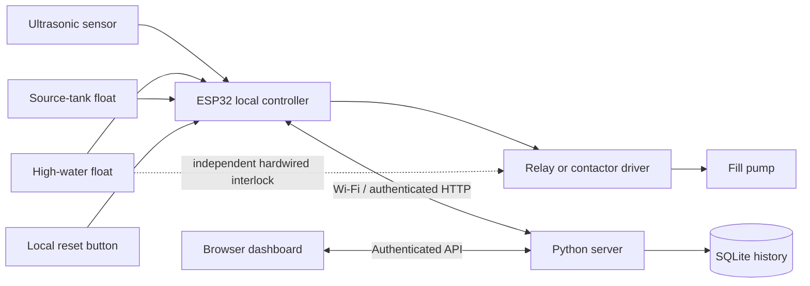

# Smart Water Tank Level Monitoring and Overflow Prevention System

A runnable IoT project using an **ESP32**, ultrasonic level sensing, local pump control, a browser dashboard, and SQLite history. Includes an accelerated simulator for demonstrations without hardware.

## Run the demonstration

Requires Python 3.10+ and a modern browser. The server has **no third-party Python dependencies**.

```powershell
cd C:\Users\user\Desktop\FSP
python -m app.server --demo
```

Open **http://127.0.0.1:8080** and paste the **dashboard access token** printed in the terminal. Select **Resume automatic**, then **Low level**. After the 10-second boot/cycling delay and three valid readings, the simulated pump fills the tank. It stops at 90%.

Try **Sensor failure**, **Source empty**, or **Float trip**. Each stops the pump and latches a fault. Choose **Restore normal**, allow three readings, then **Local reset**. Reset is a simulated physical button; the real device cannot reset faults over the network. Demo water changes faster than a real tank. Use Ctrl+C to stop the server.

## Included code

```text
app/control.py                  Simulator controller model
app/server.py                   Authenticated HTTP API, simulator, SQLite storage
web/                            Responsive dashboard, no CDN or build step
firmware/platformio.ini         Pinned ESP32/Arduino build configuration
firmware/include/tank_config.example.h  Wiring, calibration, Wi-Fi, server settings
firmware/include/controller.h   Local pump protection state machine
firmware/src/main.cpp           Sensor, GPIO, relay, Wi-Fi telemetry
firmware/test/                  Embedded controller tests (requires ESP32 to run)
tests/                          Backend, API, and simulator control tests
docs/HARDWARE.md                 Components, wiring, calibration, commissioning
docs/API.md                      Telemetry schema and dashboard endpoints
docs/PROJECT.md                  Project explanation and demonstration checklist
```

## How it works



- Starts in **OFF** after an ESP32 boot. The server also starts with requested mode OFF. Select Resume automatic after checking the installation. A restarted ESP32 may receive an existing AUTO request from a running server after uploading telemetry.
- In AUTO, starts at **25% or lower**, after three consecutive valid samples and at least **10 seconds off**. Stops at **90% or higher**. Hysteresis avoids rapid cycling.
- Invalid readings, high-water float trip, source empty, level **95% or higher**, or a continuous pump run of **15 minutes** latch a fault and disable the relay.
- Fault reset needs healthy inputs, three valid samples, a level below 90%, and a new press of the **physical reset button**. Reset may resume pumping if AUTO is selected and water is low; isolate power before servicing.
- Sensing is every 500 ms. Digital interlocks are checked between samples. Network work runs in a separate FreeRTOS task from local control.
- ESP32 uploads every 2 seconds and receives requested AUTO/OFF mode in the response. Dashboard distinguishes requested and device-reported modes. Mode confirmation can take two uploads. Request pump off is **not an emergency stop**.
- On Wi-Fi/server failure, the powered ESP32 continues its **last applied mode with local protections**. At 15 seconds without telemetry the dashboard marks the device offline. AUTO cannot be requested while offline; OFF can be queued.
- One device per server. History retains the latest 10,000 readings; the chart displays 180. Demo and live histories use separate database files. Recent activity is held in memory and resets with the server.

## Connect real hardware

1. Assemble the low-voltage prototype using [docs/HARDWARE.md](docs/HARDWARE.md). Test the relay using an LED or small DC pump first.
2. Install PlatformIO Core or the PlatformIO IDE extension. The project pins Espressif32 6.9.0 and ArduinoJson 6.21.5 for reproducible firmware builds; it targets the original dual-core ESP32 Dev Module (`esp32dev`).
3. Generate a device token and start the server on your LAN:

   ```powershell
   $env:TANK_DEVICE_TOKEN = python -c "import secrets; print(secrets.token_urlsafe(32))"
   python -m app.server --host 0.0.0.0
   ```

   Keep that PowerShell session open. Copy the device token into `tank_config.h` without posting or committing it. Dashboard and device tokens are different. Optionally set `TANK_DASHBOARD_TOKEN` to a separate generated value (24+ characters) to keep dashboard access across restarts. Otherwise a fresh token is printed at startup.

4. Copy `firmware/include/tank_config.example.h` to `firmware/include/tank_config.h`. Set Wi-Fi credentials, the same device token, and your computer's LAN IPv4 in `SERVER_URL`. Find the IPv4 with `ipconfig`. Do not use `localhost` on the ESP32. Allow inbound TCP port 8080 on your private Windows network if prompted.
5. Measure actual empty/full distances and update calibration. Verify the selected relay polarity and safe startup hardware bias.
6. Compile and flash:

   ```powershell
   pio run -d firmware -e esp32dev
   pio run -d firmware -e esp32dev -t upload
   pio device monitor -d firmware -b 115200
   ```

7. Open `http://YOUR_PC_LAN_IP:8080` from a phone/computer on the same network. Enter the dashboard token. Verify live telemetry, keep the pump disconnected during commissioning, then test AUTO and every interlock.

Both device and dashboard connections use **plain HTTP on a trusted private LAN** in this prototype; bearer tokens are not encrypted in transit. Do not forward this port to the public Internet. Remote deployment needs an HTTPS server, certificate-validated TLS on the ESP32 (replace WiFiClient with WiFiClientSecure and provision the CA), and a production server. This implementation is a lab prototype, not a certified industrial protection controller. A stuck relay or MCU cannot be stopped by software: use a correctly rated independent series float interlock and disconnect as described in the hardware guide.

## Verify

```powershell
python -m unittest discover -s tests -v
node --check web/app.js
pio run -d firmware -e esp32dev
```

To execute the embedded controller tests on a connected ESP32:

```powershell
pio test -d firmware -e controller_tests
```

The Python tests exercise the simulator model, all protection causes, hysteresis, reset rules, API authentication, validation, stale data, history, and a real HTTP telemetry/command exchange. They do not substitute for testing sensor behavior, electrical wiring, relay startup, or pump response on hardware.

## References

- [PlatformIO ESP32 Dev Module configuration](https://docs.platformio.org/en/stable/boards/espressif32/esp32dev.html)
- [Espressif Arduino Wi-Fi API](https://docs.espressif.com/projects/arduino-esp32/en/latest/api/wifi.html)
- [Espressif FreeRTOS tasks and critical sections](https://docs.espressif.com/projects/esp-idf/en/stable/esp32/api-reference/system/freertos_idf.html)
- [Espressif HTTPClient interface](https://github.com/espressif/arduino-esp32/blob/master/libraries/HTTPClient/src/HTTPClient.h)

See [docs/PROJECT.md](docs/PROJECT.md) for a ready-to-use project overview and demonstration checklist.

See [docs/VALIDATION.md](docs/VALIDATION.md) for the completed software checks and hardware testing still required. A dashboard screenshot is saved as `docs/dashboard-preview.png`.

To create a portable source ZIP without local credentials, tools, build outputs or telemetry databases:

```powershell
python scripts/package.py
```

The archive is written to `artifacts/AquaGuard-IoT-Codebase.zip`.
